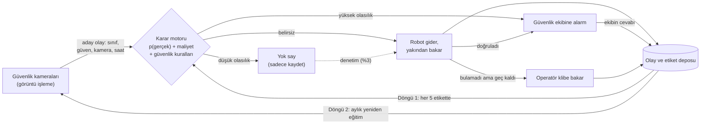

# Kamera + Robot ile Kendi Kendine Öğrenen Doğrulama Sistemi

Güvenlik kameraları fabrikada sigara, yangın/duman, açık kapı gibi istenmeyen durumları tespit eder.
Kamera emin olamadığında robot olay yerine gidip yakından bakar. Robotun (ve operatörün) verdiği her
sonuç sisteme geri döner. Böylece "bu tespitte robotu mu göndermeliyim, doğrudan alarm mı vermeliyim,
yoksa yok mu saymalıyım?" kararı zamanla kendi kendine iyileşir.

Bu klasörde:

- **`engine/`**: sahaya bağlanabilecek karar motoru (yalnızca `numpy` gerektirir).
- **`sim/`** ve **`run_simulation.py`**: 6 kameralı, 1 robotlu fabrika simülasyonu. Motoru sahaya
  çıkmadan denemek ve ödül/ceza (maliyet) tablosunu ayarlamak için.
- **`ornek_kullanim.py`**: motorun gerçek sisteme nasıl bağlanacağını gösteren çalışır örnek.

## Hızlı başlangıç

```bash
cd kamera-robot-ogrenen-dogrulama
pip install -r requirements.txt
python run_simulation.py             # sabit eşik / basit öğrenen / önerilen sistem karşılaştırması
python run_simulation.py --ablation  # önerilen sistemin her bileşeninin katkısı
python run_simulation.py --blind     # en zor kör nokta senaryosu
python ornek_kullanim.py             # olay -> karar -> robot sonucu -> öğrenme akışı
python -m unittest                   # testler
```

## Sistem nasıl çalışır?



İki ayrı öğrenme döngüsü var:

1. **Karar döngüsü (dakikalar içinde):** Her robot ve operatör sonucu bir etikettir. Karar modeli şunu
   öğrenir: "Bu kamerada, bu saatte, bu güven skoruyla gelen bu tür tespit gerçekte ne sıklıkla doğru çıkıyor?"
2. **Algı döngüsü (haftalar içinde):** Robotun doğruladığı görüntüler, kamera modelini yeniden eğitmek için
   etiketli veri olur. Kamera zamanla robota daha az ihtiyaç duyar.

## 1. "Sorun varsa ödül, yoksa ceza" fikri: doğru ama üç eksiği var

**a) Ödülün büyüklüğü olayın türüne göre değişmeli.** +1/−1 kullanırsanız sistem, olayın gerçek olma
ihtimali %50'yi geçmedikçe robot göndermez. Yangın için bu kabul edilemez. Bu yüzden her aksiyonun
*beklenen maliyeti* hesaplanır ve en ucuzu seçilir (`engine/config.py`, `CostModel`):

| Aksiyon | Beklenen maliyet (p: olayın gerçek olma olasılığı) |
|---|---|
| Yok say | p × kaçırma bedeli |
| Robot gönder | yol maliyeti + p × gecikme bedeli |
| Doğrudan alarm | (1 − p) × yanlış alarm bedeli |

Örnek değerlerle, robot 4 dakika uzaktayken:

| Sınıf | Yok say | Robot gönder | Doğrudan alarm |
|---|---|---|---|
| Sigara | p < %22 | %22 – %59 | p > %59 |
| Yangın | p < %0,2 | %0,2 – %11 | p > %11 |

Kullanıcının "ödül/ceza" fikri bu tablonun özel bir hali. "Robot gitti, olay yoktu" = yol maliyeti (küçük ceza).
"Robot gitti, olay gerçekti" = kaçırma bedelinden kurtulmak (sınıfa göre büyük ödül). Tabloda
oranlar önemlidir, birimler değil. **Bu tabloyu fabrikanın kendisi belirlemelidir.**

**b) Gidilmeyen yerin sonucu hiç gözlenemez.** Robotun gitmediği bir olayın gerçek olup olmadığını asla
öğrenemezsiniz. Literatürde bu "apple tasting" ya da "selective labels" problemi olarak bilinir. Bu yüzden
ödülü doğrudan değil, *olayın gerçek olma olasılığını* öğreniyoruz; kaçırma bedeli bu olasılık üzerinden
hesaba katılıyor. Ayrıca yok sayılan olayların küçük bir kısmına robot yine de gider (**denetim**).
Aksi halde sistem bir bölgeye bakmayı bırakır ve orada değişeni bir daha öğrenemez.

**c) "Robot bir şey bulamadı" her zaman "olay yoktu" demek değildir.** Sigara içen kişi robot gelmeden
gitmiş, kapı bu arada kapatılmış olabilir. Bunlar "yanlış alarm" diye etiketlenirse model gerçek olaylara
güvenmemeyi öğrenir ve kendini kör eder. Kural şu: robot, sınıfa özgü süreden (sigara için 2,5 dk) geç
vardıysa ve bir şey bulamadıysa sonuç kanıt sayılmaz, kamera klibine bir operatör bakar
(`engine/labeling.py`). Simülasyonda en büyük farkı yaratan bileşen budur (bkz. §4).

## 2. Neden derin pekiştirmeli öğrenme (DQN, PPO...) değil?

- **Problem bir "bağlamsal bandit" (contextual bandit) problemi.** Her olay kendi başına bir karar ve
  sonucu kısa sürede belli oluyor. Uzun vadeli plan gerektiren tam RL'ye ihtiyaç yok.
- **Gerçek olaylar nadir.** Fabrikada yılda birkaç yangın girişimi olur. Derin RL milyonlarca örnek ister;
  burada ayda birkaç yüz etiket var. Bayesçi model az veriyle çalışır ve ne kadar emin olmadığını bilir.
- **Güvenlik.** RL deneme-yanılmayla öğrenir; "yangını yok saymayı denemek" kabul edilemez. Burada öğrenme
  yalnızca güvenlik kurallarının bıraktığı alanda karar verir.
- **Açıklanabilirlik.** Modelin her ağırlığı okunabilir: "Kaynak atölyesindeki gündüz yangın tespitlerinin
  %4'ü gerçek."
- RL'nin gerçekten anlamlı olacağı yer daha sonra gelir: robotun nerede bekleyeceği, devriye rotası,
  çoklu robot görev dağıtımı (bkz. §8, Faz 3).

## 3. Karar motoru (`engine/`)

Her kamera olayı için (`DecisionEngine.decide`):

1. **Güvenlik kuralları** izin verilen aksiyonları belirler. Öğrenme bunları aşamaz (`SafetyRules`):
   yangın güveni ≥ 0,85 (duman için 0,95) ise doğrudan alarm, yangın/duman güveni ≥ 0,25 ise asla
   yok sayılmaz, robot yoksa robot seçeneği kalkar.
2. **Model** olayın gerçek olma olasılığını ve bu tahmindeki belirsizliği verir. Kullanılan model
   Bayesçi lojistik regresyon. Bağlam olarak sınıf, kamera, kamera güveni, kamera × sınıf,
   kamera × gece ve tespitin süresi kullanılır.
3. **Bakmalı mı?** Bakmanın beklenen maliyeti yok saymaktan düşükse bakılır.
4. **Robot mu, alarm mı?** Hangisinin beklenen maliyeti düşükse o seçilir.
5. **Denetim:** "Yok say" kararlarının %3'ünde robot yine de gider ve bu kayda geçer.

Öğrenme tarafında üç ayar önemli:

- **Başlangıç bilgisi:** Model "kameranın güven skoru doğrudur" (p = güven) varsayımıyla başlar.
  Yani ilk gün bugünkü sistem kadar iyidir, sonra sahadan gelen etiketlerle düzelir.
- **Unutma:** Eski etiketlerin ağırlığı 30 günde yarıya iner. Fabrika değişir: yerleşim, aydınlatma,
  insanların alışkanlıkları.
- **Kayıt:** Her karar, seçilme olasılığıyla (propensity) birlikte `EventStore`'a (SQLite) yazılır.
  Servis yeniden başlasa da model kayıtlardan aynen kurulur.

Thompson örneklemesi (belirsiz bağlamları daha sık denemek) de `LearningConfig(exploration="thompson")`
ile seçilebilir. Simülasyonda denetime göre ek fayda sağlamadığı için varsayılan değildir. Kamera güven
skorlarındaki doğal çeşitlilik zaten keşif sağlıyor; bu, bağlamsal bandit literatüründe de bilinen bir
durumdur (Bastani, Bayati ve Khosravi, 2021).

## 4. Simülasyon sonuçları

Senaryo (`sim/scenario.py`), 6 kamera ve 1 robot (0,7 m/s), 120 gün. Her kameranın gerçek fabrikalarda
görülen bir zaafı var:

| Kamera | Zaaf |
|---|---|
| K1, K2 Üretim hatları | İyi aydınlatılmış; güven skoru gerçeğe yakın |
| K3 Kaynak atölyesi | Mesaide kıvılcım ve kaynak dumanı yangın/duman sanılıyor |
| K4 Kazan dairesi | Buhar gece gündüz duman sanılıyor |
| K5 Yükleme rampası | Gündüz güneş yansıması kapıyı açık gösteriyor; gerçekten açık unutulan kapı gece |
| K6 Depo arkası | Karanlık ve uzak; havalandırma buharı sigaraya benziyor. **45. günden sonra sigara içenler burayı kör nokta olarak keşfediyor** |

`python run_simulation.py` çıktısı (5 farklı rastgele olay akışının ortalaması):

| | Sabit eşik (bugünkü tipik sistem) | Basit öğrenen (ilk fikir) | **Önerilen** |
|---|---:|---:|---:|
| Toplam maliyet (puan) | 37.536 | 30.765 | **29.959** |
| Kaçırılan gerçek olay (120 günde) | 181 | 213 | **70** |
| Kör nokta yakalama (K6 sigara, 45. gün sonrası) | %35 | %10 | **%79** |
| Robot görevi / gün | 17,2 | 14,3 | 17,0 |
| İnsanlara giden yanlış alarm / gün | 1,7 | 0,9 | 1,3 |
| Operatör klip incelemesi / gün | 0 | 0 | 2,0 |
| Kaçırılan yangın | 1 yangın / 25 (5 akışta) | 0 | 0 |

- *Sabit eşik*: güven ≥ 0,8 alarm, 0,4–0,8 robot, altı yok say; öğrenmez.
- *Basit öğrenen*: ödül/cezayı öğrenir ama denetim yapmaz, eski bilgiyi unutmaz, "robot bulamadı"yı
  "yanlış alarm" sayar.

**Sonuçlardan çıkan dersler:**

1. **Öğrenme işe yarıyor.** Önerilen sistem sabit eşiklere göre maliyeti %20, kaçırılan gerçek olayı
   %61 azaltıyor. Model, kameranın kendi güven skorunun nerede yanıldığını öğreniyor:

   | Bağlam (son 60 gün) | Kamera güveni | Gerçekte oran | Model tahmini |
   |---|---:|---:|---:|
   | Kaynak atölyesi · yangın · gündüz | %66 | %0 | %4 |
   | Kazan dairesi · duman · gündüz | %52 | %1 | %3 |
   | Yükleme rampası · açık kapı · gündüz | %63 | %8 | %15 |
   | Yükleme rampası · açık kapı · gece | %69 | %78 | %66 |
   | Depo arkası · sigara · gündüz | %41 | %57 | %52 (basit öğrenen: %9) |

2. **Basit öğrenen sistem tuzaktır.** Sahada görebildiğiniz her göstergede en iyisi o: en az robot görevi,
   en az yanlış alarm. Gerçekte ise en çok olayı kaçıran o (213; sabit sistemden bile fazla). Kör noktanın
   yalnızca %10'unu yakalıyor. Kaçırılan olaylar sahada görünmediği için bunu raporlardan **fark edemezsiniz**.
3. **Bileşenlerin katkısı** (`--ablation`; "zor" sütunu `--blind`: K6'da gerçek ve yanlış tespitler
   kamerada birebir aynı görünüyor):

   | Önerilen sistemde... | Toplam maliyet | Kaçırılan olay | Kör nokta yakalama | Zor kör nokta yakalama |
   |---|---:|---:|---:|---:|
   | hiçbir şey değiştirilmezse | 29.959 | 70 | %79 | %65 |
   | dikkatli etiketleme kaldırılırsa | 31.052 | 191 | %20 | %13 |
   | unutma kaldırılırsa | 30.151 | 118 | %55 | %56 |
   | denetim kaldırılırsa | 29.820 | 76 | %76 | %48 |
   | keşif Thompson ile yapılırsa | 30.362 | 85 | %75 | %69 |

   En kritik bileşen dikkatli etiketlemedir. Unutma, değişime uyum sağlar. Denetim, sinyalin hiç olmadığı
   kör noktada fark yaratır. Toplam maliyetler birbirine yakın, çünkü bu tabloda bir sigarayı kaçırmak
   (40 puan) aşağı yukarı 4–5 robot görevine eşit. Bu takası belirleyen maliyet tablosudur.
4. **Kalan en büyük maliyet algıda.** Robot görevlerinin %58'i kaynak kıvılcımı ve kazan buharı gibi
   yangın/duman yanlış tespitlerine gidiyor. Güvenlik kuralı gereği bunlar yok sayılamaz, karar modeli de
   bunları azaltamaz. Çözüm Döngü 2: robotun topladığı bu "zor negatiflerle" kamera modelini yeniden
   eğitmek (bkz. §6).

> Sayılar temsili bir senaryodan geliyor; amaç mekanizmaları göstermek. Kendi kamera ve olay
> istatistiklerinizi `sim/scenario.py`'ye, maliyetlerinizi `engine/config.py`'ye girip tekrar çalıştırın.

## 5. Sahada kaçırılanları nasıl görürsünüz?

Kaçırılan olayları sahada doğrudan göremezsiniz. Tek pencere **denetimlerdir**. Model "yok saydığım
olayların %5'i gerçek" diyorsa ama denetimlerin %30'u gerçek çıkıyorsa, model o bölgede körleşmiştir.
`engine.estimated_missed()` bunu sayıya çevirir: denetim olasılığı *a* iken bulunan her gerçek olay,
denetlenmeden geçen ortalama (1−a)/a olayı temsil eder.

Bu tahmin kabadır. %3 denetimde her isabet ~32 olaya karşılık geldiği için oldukça oynaktır. Robotun
yanlışlıkla "var" dediği durumlar da tahmini yukarı çeker (simülasyonda gerçek 50, tahmin 91). Doğrulama
hatasızken tahmin yansızdır (gerçek 81, tahmin 84). Amaç kesin sayı değil, kör noktayı erken fark etmektir.

**Haftalık izlenecek göstergeler:**

- kamera × sınıf bazında denetim isabet oranı ile modelin tahmini (kalibrasyon)
- robot görevi/gün ve bunların ne kadarının yanlış tespite gittiği
- insanlara giden yanlış alarm/gün
- operatör inceleme kuyruğu
- ortalama doğrulama süresi
- etiket kaynağı dağılımı (robot / operatör / tatbikat)

## 6. Algı döngüsü: kamera modelini robotun etiketleriyle yeniden eğitmek

```python
store.export_training_manifest("egitim_listesi.csv")
```

Bu çağrı doğrulanmış her olayı görüntü yoluyla birlikte dışa aktarır ve şöyle işaretler:

- `hard_negative`: kamera emindi ama olay yoktu (buharı duman sandı). En değerli örnekler bunlar.
- `hard_positive`: kamera emin değildi ama olay vardı (karanlıkta sigara).

Önerilen akış:

1. Ayda bir bu örneklerle kamera modeli (ör. YOLO) ince ayarlanır.
2. **Hiç değişmeyen bir test setinde** eski modelle karşılaştırılır.
3. Daha iyiyse önce tek kamerada, sonra kademeli olarak dağıtılır.

Dikkat edilecek iki nokta:

- **Kamera modeli güncellenince** karar modelinin o kamera için öğrendiği düzeltmeler eskir, çünkü
  güven skorlarının anlamı değişir. Model sürümünü bağlama ekleyin ya da o kameranın eski etiketlerini
  devre dışı bırakın.
- **Hakem ile oyuncu ayrı olmalı.** Robotun kendi algı modeli (doğrulayıcı) bu ödülle eğitilmemelidir.
  "Sorun bulursan ödül" diye eğitilen doğrulayıcı her şeyde sorun görmeyi öğrenir. Doğrulayıcı yalnızca
  operatörün onayladığı etiketlerle eğitilir.

Yangın gibi nadir olaylar için gerçek veri yetmez. Kontrollü tatbikatlar (duman testi) ve geçmiş kayıtlar
`engine.add_example(...)` ile sisteme etiketli örnek olarak eklenebilir. Aynı metot **gölge mod** için de
kullanılır.

## 7. Robot tarafı: "yakından bakmak" ne demek?

| Sınıf | Robotun bakacağı şey |
|---|---|
| Yangın | Termal kamera (sıcak nokta), alev sensörü (UV/IR), CO sensörü (yanma CO üretir, buhar üretmez). Güvenli mesafede durur |
| Duman | Partikül sensörü ile CO ve nem birlikte değerlendirilir; buhar nemi artırır ama CO üretmez |
| Sigara | Termal kamerada yanan uç (birkaç yüz °C) çok belirgindir; VOC/partikül sensörü, yakın plan RGB. Robot hoparlöründen uyarı da verebilir |
| Açık kapı | LiDAR/derinlik kamerasıyla kapı açısı. Kalıcı çözüm: kapıya manyetik kontak sensörü. Robot göndermekten ucuz ve kesin |

- **Hedef konum:** Kamera pikseli, zemin düzlemine homografi ile çevrilir (kamera başına bir kez 4+ nokta
  kalibrasyonu). Robot olayın üstüne değil, olayı iyi gören bir bakış noktasına gider (ROS 2 Nav2 `NavigateToPose`).
- **ETA:** Karar motoru robotun tahmini varış süresini (kuyruk dahil) ister. Nav2'nin planladığı yol
  uzunluğu ve hız ile hesaplanabilir.
- **Robotun cevabı:** `confirmed` / `not_found` / `inconclusive` ve varış gecikmesi (dk). Gecikme bilgisi,
  "bulamadım" sonucunun kanıt sayılıp sayılmayacağını belirler.

## 8. Gerçek sisteme bağlama

Tam akış `ornek_kullanim.py`'de. Özeti:

```python
from engine import Action, CameraEvent, DecisionEngine, EngineConfig, EventStore, RobotVerdict

engine = DecisionEngine(EngineConfig(cameras=("K1", "K2", "K3")), store=EventStore("olaylar.db"))

# 1) Kamera analitiğinden olay geldiğinde (ör. MQTT "kamera/olay")
ev = CameraEvent(event_id="olay-1", camera_id="K3", cls="smoking", conf=0.45,
                 ts=1793358000.0, hour=14.0,  # 30.10.2026 14:00 (TSİ)
                 track_sec=30.0, snapshot="/kayit/olay-1.jpg")
d = engine.decide(ev, eta_min=filo.tahmini_varis("K3"))  # robot yoksa eta_min=None
if d.action is Action.DISPATCH:
    filo.gorev_gonder(ev)          # ROS 2 action veya MQTT "robot/gorev"
elif d.action is Action.ALARM:
    guvenlik_ekibine_bildir(ev)

# 2) Robot incelemeyi bitirdiğinde
fb = engine.record_robot_result("olay-1", RobotVerdict.NOT_FOUND, arrival_delay_min=4.2)
if fb.needs_review:
    operator_kuyrugu.ekle("olay-1")  # robot geç kaldı: klibe bir insan baksın

# 3) Operatör cevabı (alarm sonrası ya da klip incelemesi)
engine.record_human_label("olay-1", is_real=True)
```

`filo`, `guvenlik_ekibine_bildir` ve `operator_kuyrugu` sizin sisteminize ait parçalardır.
Karar motoru iletişim katmanından bağımsızdır; MQTT köprüsü, ROS 2 düğümü veya REST servisi içinde çalışabilir.

## 9. Yol haritası

| Faz | Süre | Ne yapılır |
|---|---|---|
| 0. Gölge mod | 2–4 hafta | Mevcut sistem çalışmaya devam eder. Her olay, robot sonucu ve operatör cevabı kaydedilir. Motor `decide` ile yalnızca "ben olsam ne yapardım" der, `add_example` ile öğrenir. Maliyet tablosu ekiple birlikte belirlenir |
| 1. Karar motoru devrede | — | Güvenlik kuralları sabit, %3 denetim açık, haftalık gösterge raporu. Bir kamerada başlayıp yayılır |
| 2. Algı döngüsü | aylık | Robotun topladığı zor örneklerle kamera modeli yeniden eğitilir ve sabit test setinde karşılaştırılır |
| 3. Robot konumlandırma | — | Olayların sık olduğu yer ve saatlere göre robotun bekleme noktası ve devriye rotası optimize edilir. Pekiştirmeli öğrenmenin gerçekten anlamlı olduğu yer burasıdır |

## 10. Dikkat: KVKK ve iş güvenliği

- **KVKK:** Sigara tespiti kişileri görüntüler, yani kişisel veri işlenir. Çalışanlara aydınlatma metni
  verilmeli, saklama süresi ve erişim yetkileri tanımlanmalı. Eğitim verisinde yüzler mümkünse bulanıklaştırılmalı.
- **İş güvenliği:** Robot insanlarla aynı alanda hareket eder. Hız sınırı, güvenlik tarayıcıları ve
  ilgili standartlar (ör. ISO 3691-4) değerlendirilmeli. Yangında robot hiçbir zaman müdahale eden ilk
  ve tek unsur olmamalı; alarm her zaman insanlara gider.

## Dosya yapısı

```
engine/
  types.py      CameraEvent, Decision, Action, RobotVerdict
  config.py     CostModel (ödül/ceza tablosu), SafetyRules, LearningConfig
  features.py   olay -> özellik vektörü, başlangıç bilgisi (prior)
  model.py      Bayesçi lojistik regresyon (Laplace yaklaşımı)
  labeling.py   robot sonucu -> etiket ("bulamadı" ne zaman kanıttır?)
  engine.py     DecisionEngine: karar, öğrenme, denetim, kaçırma tahmini
  store.py      SQLite olay/etiket deposu, eğitim listesi dışa aktarımı
sim/
  scenario.py   örnek fabrika: kameralar, olay sıklıkları, kör nokta
  world.py      ayrık olay simülasyonu: robot kuyruğu, doğrulama, maliyet
  policies.py   sabit eşik, basit öğrenen, önerilen ve ablasyon varyantları
run_simulation.py   karşılaştırma raporu
ornek_kullanim.py   entegrasyon örneği
tests/              birim ve simülasyon testleri
```

## Sınırlamalar

- Simülasyon temsilidir. Kamera zaafları, olay sıklıkları ve maliyetler varsayımdır; sahadan gelen gerçek
  verilerle yeniden ayarlanmalıdır.
- Tek robot varsayıldı. Birden fazla robotta ETA, en uygun robotun ETA'sı olarak verilebilir;
  görev dağıtımı ayrı bir problemdir.
- Model doğrusal (lojistik). Kamera ve bağlam sayısı çok artarsa hiyerarşik önsel ya da kalibre
  edilmiş gradyan artırma (gradient boosting) düşünülebilir. Karar ve keşif mantığı aynı kalır.
